  

Hi, I am **Wee Zhern Ray**, a Chemical Engineering student at the National University of Singapore (NUS) with a minor in Low-Carbon Energy and Hydrogen Technologies and a specialisation in Safety and Sustainability. I am involved in nuclear engineering research at NUS.

[Personal website](https://weewzr.github.io/weewzr/) | [LinkedIn](https://www.linkedin.com/in/wee-zhern-ray/) | [Featured projects](#featured-projects)

 

## About

Alongside my research involvement in nuclear engineering, I build computational models of chemical and energy systems, from fission-product transport in fuel particles to low-carbon hydrogen and aviation fuel systems.

I care about models that can be checked. Each project below states its assumptions and checks its results against an independent method where one exists. The write-ups also say what each model leaves out.

**Affiliations:** [Singapore Nuclear Research and Safety Institute (SNRSI), NUS](https://snrsi.nus.edu.sg) (Dr Ong Kay Chen Theodore, Dr Xiao Sicong) for research involvement in nuclear engineering; [Department of Chemical and Biomolecular Engineering, NUS](https://cde.nus.edu.sg/chbe/) (Suraj Vasudevan).

## Research Interests

Nuclear engineering is where I am actively involved in research at NUS. The other five areas are interests that shape my studies and public projects.

| Area | Status | Focus |
| --- | --- | --- |
| **Nuclear Engineering & Energy Systems** | Research involvement | Nuclear engineering research at NUS, plus a public computational project on fission-product release from TRISO fuel particles. |
| **Hydrogen & Low-Carbon Technologies** | Interest | Low-carbon hydrogen routes for Singapore, including nuclear-heated steam methane reforming with carbon capture and sustainable aviation fuel supply chains. |
| **Chemical Process Modelling & Simulation** | Interest | Mass and energy balances and flowsheet logic in reproducible process models, with inputs traced to a source and results checked against independent calculations. |
| **Techno-Economic Analysis** | Interest | Levelised cost and abatement cost ledgers, with sensitivity and scenario studies that show which assumptions drive a result. |
| **Process Safety & Sustainability** | Interest | Safety and sustainability thinking applied to energy systems, following my specialisation in Safety and Sustainability at NUS. |
| **Scientific Computing & Numerical Methods** | Interest | Finite-volume and eigenfunction methods for diffusion, and mixed-integer optimisation for supply networks, written in Rust and Python and verified with convergence and balance checks. |

## Technical Skills

Tools are listed without proficiency ratings. The repositories below show how each one is used.

| Category | Tools and methods |
| --- | --- |
| **Programming** | Python, Rust, WebAssembly, JavaScript, LaTeX |
| **Engineering** | Process simulation, Process modelling, Engineering optimisation, Techno-economic analysis |
| **Scientific Computing** | Numerical modelling, Data analysis, Computational methods, Verification and validation |
| **Development** | Git, GitHub, GitHub Actions, GitHub Pages, Cargo |

## Featured Projects

### KASCO: Kalimantan SAF Supply Chain Optimiser

**Live prototype** | [Live app](https://weewzr.github.io/KASCO/) | [Repository](https://github.com/weewzr/KASCO)

A working planning tool for a Sustainable Aviation Fuel network across Kalimantan, with a Rust solver compiled to WebAssembly so that the whole product runs in the browser with no server.

- Lagrangian branch-and-bound over refinery sites with exact min-cost flow.
- Independent validation: balances recomputed from flow records, with a HiGHS second opinion.
- Interactive network map and an editable scenario simulator that reruns the real solver in the browser.

**Stack:** Rust, WebAssembly, HiGHS, Python, GitHub Pages

### NUS-H2: Nuclear-heated steam methane reforming with carbon capture

**Complete study with live simulator** | [Live simulator](https://weewzr.github.io/NUSH2/) | [Repository](https://github.com/weewzr/NUSH2)

A low-carbon hydrogen study for Singapore with an open engine and a browser simulator. A high-temperature gas-cooled reactor supplies process heat to steam methane reforming, and an amine unit captures the carbon dioxide.

- Layered Rust engine with every input in a sourced parameter register.
- Mass and energy balances, an emissions ledger, a levelised cost ledger and a discounted cash flow cross-check.
- Interactive process flow diagram, parameter editing, results export and a validation matrix.

**Stack:** Rust, WebAssembly, JavaScript, Python, LaTeX, GitHub Actions

### STRATO: Spherical TRISO Analysis and Transport Operations

**v1.0, Phase 1** | Website coming soon | [Repository](https://github.com/weewzr/STRATO)

A transparent, verifiable model of fission-product release from a single TRISO coated fuel particle. It solves the same multilayer spherical diffusion problem with a finite-volume method and with an exact eigenfunction series, so each method checks the other.

- Five-layer particle: kernel, buffer, inner PyC, SiC and outer PyC.
- Finite-volume solver with exact shell geometry, series interface conductances and Backward Euler stepping.
- Analytical multilayer eigenfunction solver and full written derivations of both methods.

**Stack:** Rust, Python, Finite volume, Sturm-Liouville expansion, GitHub Actions

## Connect

- Personal website: [weewzr.github.io/weewzr](https://weewzr.github.io/weewzr/)
- LinkedIn: [Wee Zhern Ray](https://www.linkedin.com/in/wee-zhern-ray/)
- GitHub: [weewzr](https://github.com/weewzr)

  Perry the Platypus is a Disney character. Unofficial fan tribute. Not affiliated with or endorsed by Disney.

